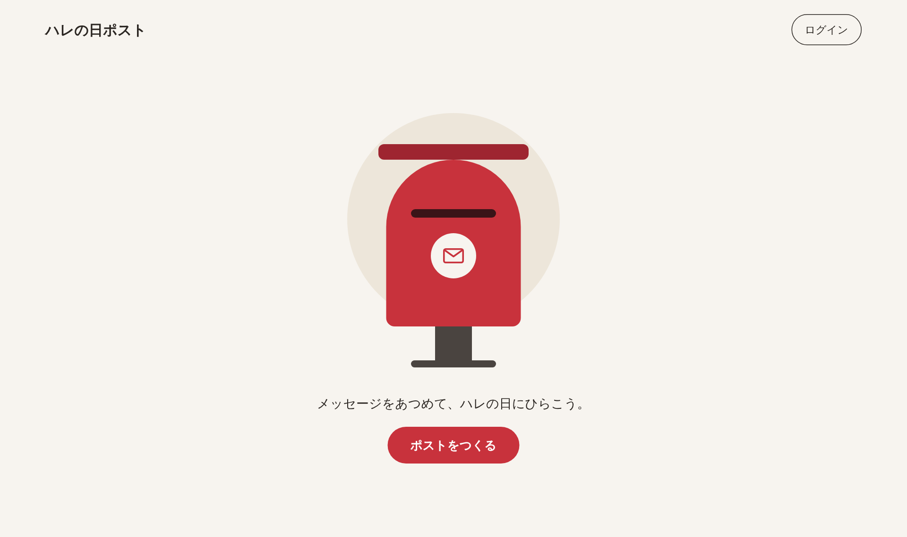

# ハレの日ポスト

記念日のメッセージを集めて、その日にひらく「ポスト（郵便ポスト）」をつくる Web サービスです。

1. 会員が記念日（お正月・誕生日・クリスマス）を選んでポストをつくる
2. ポストのリンクを SNS などで共有する
3. リンクを受け取った人は **ログインなしで** カードを書いて投函できる
4. **開封日になると、持ち主だけ** がカードを読める（それまでは何通届いたかだけが見える）

**デモ**: http://43.200.133.12:8080/ （AWS EC2。HTTP のみ・停止している場合があります）



## 主な機能

| 区分 | 機能 |
|---|---|
| 会員 | 新規登録（ID 重複確認・メール認証 6 桁コード）、ログイン、マイページ、プロフィール・パスワード変更、退会 |
| ポスト | 記念日 3 種類から作成（お正月 1/1・クリスマス 12/25 は開封日固定、誕生日は登録した誕生日から変更可）、共有リンク、受付中は 5 つまで |
| かざり | テーマごとの飾り（屋根の上・前・横）を複数選択、名札（8 文字）、プレビュー |
| カード | ログインなしで投函（デザイン選択・名前・メッセージ）、ページを更新せずに封筒が増える |
| 開封 | 開封日以降、持ち主だけがカードを読める。既読表示、不適切なカードの通報 |
| 管理者 | 通報の確認・処理・カード削除、カードデザイン画像のアップロード・表示順・使用有無 |

## 技術スタック

| 区分 | 内容 |
|---|---|
| 言語 / ビルド | Java 21, Gradle |
| フレームワーク | Spring Boot 4.0, Spring Security, Spring Data JPA, Thymeleaf, Bean Validation, Java Mail |
| フロント | Thymeleaf + jQuery 3.7.1（ajax）+ 自作 CSS / SVG イラスト |
| DB | Oracle Database 21c XE（Docker） |
| インフラ | AWS EC2（t3.small, Amazon Linux 2023）, systemd, Elastic IP |

## 工夫した点

- **開封前は本文を返さない**: 開封日前はカード本文をどの応答（HTML・ajax）にも入れず、件数と封筒（差出人名・デザイン）だけを返す。本文入りの DTO（`CardResponseDTO`）は「持ち主かつ開封後」をサーバーで確認したカード一覧画面だけで使い、ポスト画面は本文を持たない `EnvelopeResponseDTO` を使う
- **すべてサーバーで検査**: 持ち主チェック、開封日チェック、テーマに合う飾り・デザインかどうか、入力文字数（日本語・絵文字は文字数で数える）
- **連投防止**: 同じ IP からのカードは 1 分に 1 通（429）。`X-Forwarded-For` は同じサーバーのプロキシ経由のときだけ信頼し、ヘッダーの偽装で制限を回避できないようにした
- **セキュリティ**: BCrypt、CSRF（ajax にもヘッダーで付与）、XSS 対策（`th:text` と jQuery `.text()` のみ）、管理者ページは `ROLE_ADMIN` のみ
- **日本時間**: JVM・OS・DB すべて Asia/Tokyo。カウントダウンは `+09:00` 付きの ISO 文字列
- **エラー表示**: 画面リクエストはポップアップ（「OK」で前の画面へ）、ajax は状態コード + メッセージ。想定外の例外の詳細は画面に出さずログだけに残す
- **2GB メモリでの運用**: Oracle XE のメモリ（SGA 640MB）・JVM ヒープ（512MB）・スワップを調整して、t3.small 1 台にアプリと DB を同居させた

## 画面

| URL | 画面 |
|---|---|
| `/` | メイン |
| `/User/user_insert` | 新規登録 |
| `/User/user_mypage` | マイページ |
| `/Post/post_write` | ポストをつくる |
| `/post/{code}` | ポスト画面（共有リンク・カードを書く） |
| `/Post/post_decorate?code=` | ポストをかざる |
| `/Card/card_list?code=` | カードを読む（持ち主・開封後） |
| `/Admin/admin_reports`, `/Admin/admin_designs` | 管理者 |

一覧・API・エラーコードの詳細は [docs/06_api.md](docs/06_api.md) を参照してください。

## ディレクトリ構成

```
src/main/java/com/harenopost
 ├─ controller   画面・ajax（User, Post, Card, Admin, Index）
 ├─ dto          RequestDTO / ResponseDTO, enum（Role, Theme, Deco）
 ├─ entity       JPA エンティティ（関連は @ManyToOne ではなく Long の FK）
 ├─ repository   Spring Data JPA
 ├─ service      業務ロジック・サーバー側の検査
 ├─ exception    ErrorCode, BusinessException, GlobalExceptionHandler
 ├─ config       SecurityConfig, WebConfig（アップロード画像）, LoginSuccessHandler
 └─ util         SecurityUtil
src/main/resources/templates   User / Post / Card / Admin / Include / error
sql/schema.sql                 Oracle DDL
docs/                          設計書（韓国語）
design/                        静的な画面デザイン案
```

## ローカルでの実行

必要なもの: Java 21、Oracle Database（`sql/schema.sql` でテーブルを作成）

1. 秘密情報の設定ファイルをコピーして値を入れる（git には含めない）
   ```
   cp src/main/resources/application-secret.yml.example src/main/resources/application-secret.yml
   ```
   - `spring.datasource.*`: Oracle の接続先
   - `spring.mail.*`: 認証コードを送る Gmail アカウント（アプリパスワード）。空のままだと、local プロファイルでは認証コードをサーバーログに出力する
2. 起動
   ```
   ./gradlew bootRun
   ```
   → http://localhost:8080/
3. テスト（DB 不要）
   ```
   ./gradlew test
   ```

管理者アカウントは `tbl_user` の `role` を `ROLE_ADMIN` にし、パスワードには BCrypt でハッシュ化した値を入れます。

## デプロイ

`./gradlew bootJar` で作った jar（秘密情報の設定ファイルは含めない）を EC2 にコピーし、systemd サービスとして動かしています。
秘密情報はサーバーの環境変数ファイル（権限 600）にだけ置いています。手順は [docs/09_deploy.md](docs/09_deploy.md) を参照してください。

## ドキュメント

| ファイル | 内容 |
|---|---|
| [docs/01_overview.md](docs/01_overview.md) | サービス概要・用語・テーマと飾り |
| [docs/02_requirements.md](docs/02_requirements.md) | 要件定義 |
| [docs/03_functional_spec.md](docs/03_functional_spec.md) | 機能仕様 |
| [docs/04_usecases.md](docs/04_usecases.md) | ユースケース |
| [docs/05_database.md](docs/05_database.md) | ERD・テーブル定義 |
| [docs/06_api.md](docs/06_api.md) | URL・ajax・エラーコード |
| [docs/07_screens.md](docs/07_screens.md) | 画面デザイン案とテンプレートの対応 |
| [docs/08_tasks.md](docs/08_tasks.md) | 開発スケジュール（2026/10/12〜10/26） |
| [docs/09_deploy.md](docs/09_deploy.md) | EC2 へのデプロイ |
