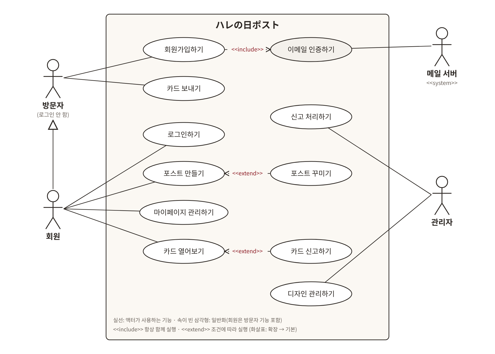

# 04. 유스케이스

| 액터 | 유스케이스 |
|---|---|
| 방문자 | 회원가입하기(«include» 이메일 인증하기), 카드 보내기 |
| 회원(방문자 기능 포함) | 로그인하기, 포스트 만들기(«extend» 포스트 꾸미기), 마이페이지 관리하기, 카드 열어보기(«extend» 카드 신고하기) |
| 관리자 | 신고 처리하기, 디자인 관리하기 |
| 메일 서버 | 이메일 인증하기 |

---

## UseCase_M_01 회원가입하기
- 액터: 방문자, 메일 서버 / 사전조건: 로그인 안 한 상태
- 기본흐름
  1. 「ログイン」→「新規登録」으로 가입 화면 진입
  2. 아이디 입력 →「重複確認」→ 사용 가능 표시
  3. 이메일 입력 →「認証コード送信」→ 서버가 6자리 코드를 세션에 저장하고 메일 발송 («include» 이메일 인증하기)
  4. 코드 입력 →「確認」→ 인증 완료 표시
  5. 패스워드, 닉네임, 생일(선택) 입력 →「登録する」→ 서버 재검사, BCrypt 저장, 로그인 화면으로
- 대체흐름: 2a 아이디 사용 중 → 다른 아이디 입력 / 4a 코드 불일치·만료 → 재발송
- 예외: 메일 발송 실패 →「メールを送信できませんでした」/ 중복확인·인증 전에는 가입 버튼 비활성
- 특수요구: 코드는 응답에 넣지 않고 서버에서만 비교

## UseCase_P_01 포스트 만들기
- 액터: 회원 / 사전조건: 로그인
- 기본흐름
  1. 「ポストをつくる」→ 만들기 화면
  2. 기념일(お正月 / 誕生日 / クリスマス) 선택 → 배경·장식 미리보기, 개봉일·이름 기본값 채움
  3. 誕生日이면 개봉일 수정 가능 →「つくる」
  4. 랜덤 코드로 저장 → 완료 화면(링크, 「コピー」「ポストをかざる」「ポストを見る」)
- 대체흐름: 2a 誕生日인데 생일 미등록 → 개봉일 직접 입력 / 4a「ポストをかざる」→ 포스트 꾸미기(«extend»)
- 예외: 비로그인 → 로그인 후 복귀 / 과거 개봉일 / 受付中 포스트 5개 초과
- 특수요구: お正月·クリスマス 개봉일은 서버가 계산(JST)

## UseCase_P_02 포스트 꾸미기
- 액터: 회원 / 사전조건: 로그인, 포스트 주인, 개봉 전
- 기본흐름
  1. 포스트 화면「かざる」→ 꾸미기 화면(빨간 우체통 미리보기)
  2. 테마 장식을 여러 개 선택/해제, 이름표(8자) 입력 → 미리보기 즉시 반영
  3. 「保存する」→ 서버가 주인·개봉 전·허용 장식 확인 후 저장 →「保存しました」
- 대체흐름: 저장 안 하고 나가면 반영 안 됨
- 예외: 주인 아님 403 / 개봉 후「開封後は変更できません」
- 특수요구: 장식은 코드 CSV로 저장, 포스트 테마의 장식만 허용

## UseCase_C_01 카드 보내기
- 액터: 방문자(회원 포함) / 사전조건: 포스트 존재, 개봉 전
- 기본흐름
  1. 공유 링크 접속 → 배경, 우체통, 카운트다운, 카드 수 표시
  2. 「カードを書く」→ 작성 모달
  3. 디자인 선택, 이름·메시지 입력 →「投函する」
  4. 서버가 입력·도배 확인 후 저장 → 모달 닫고 봉투 추가, 카드 수 +1
- 대체흐름: 회원이면 이름 자동 입력 / 1분 내 재전송 → 안내 메시지
- 예외: 개봉 후 → 수신 마감 / 없는 링크 → 404 화면
- 특수요구: 개봉 전 본문은 어떤 응답에도 포함 금지

## UseCase_C_02 카드 열어보기
- 액터: 회원 / 사전조건: 로그인, 포스트 주인, 개봉 후
- 기본흐름
  1. 포스트 화면 또는 마이페이지에서「カードをひらく」
  2. 카드 목록(보낸 이름, 디자인, 未読 표시)
  3. 카드 클릭 → 모달로 본문, 처음 연 카드는 읽음 처리
- 대체흐름: 부적절한 카드 →「通報」(«extend» 카드 신고하기)
- 예외: 개봉 전 → 포스트 화면으로 / 주인 아님 403
- 특수요구: 주인·개봉일 확인은 서버에서
