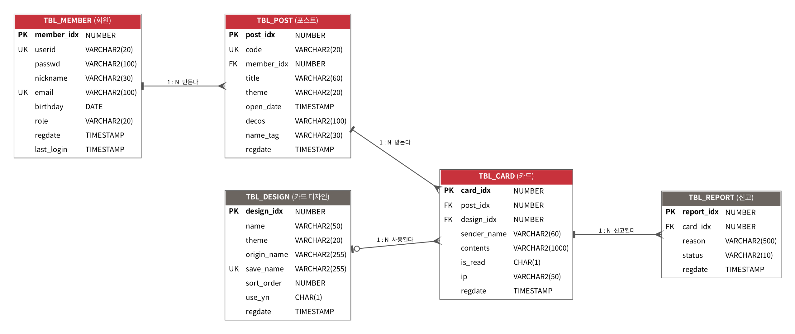
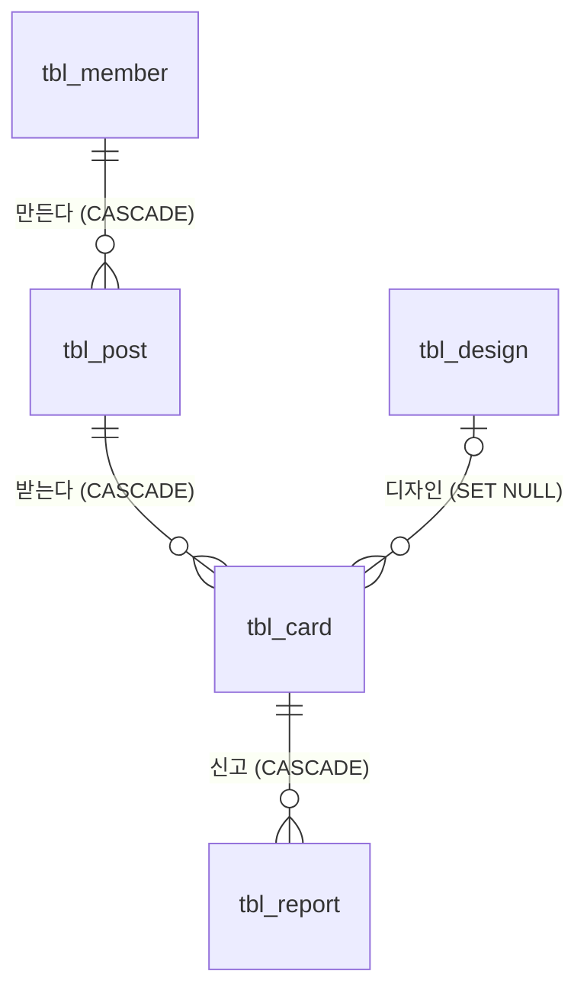

# 05. 데이터베이스

DDL 원본: `sql/schema.sql` (Oracle). 서버에서는 이 파일로 직접 만들고 JPA는 `ddl-auto: none`(로컬에서도 `validate` 권장).





## 테이블

### tbl_member — 회원
| 컬럼 | 타입 | 제약 | 설명 |
|---|---|---|---|
| member_idx | NUMBER | PK, seq_member | |
| userid | VARCHAR2(20) | NOT NULL, UNIQUE | 로그인 ID |
| passwd | VARCHAR2(100) | NOT NULL | BCrypt |
| nickname | VARCHAR2(30) | NOT NULL | 10자 |
| email | VARCHAR2(100) | NOT NULL, UNIQUE | |
| birthday | DATE | | 선택 |
| role | VARCHAR2(20) | 'ROLE_USER' / 'ROLE_ADMIN' | |
| regdate | TIMESTAMP | DEFAULT SYSTIMESTAMP | |
| last_login | TIMESTAMP | | 로그인 성공 시 갱신 |

### tbl_post — 포스트
| 컬럼 | 타입 | 제약 | 설명 |
|---|---|---|---|
| post_idx | NUMBER | PK, seq_post | |
| code | VARCHAR2(20) | NOT NULL, UNIQUE | 공유용 8자 |
| member_idx | NUMBER | FK → tbl_member, CASCADE | 주인 |
| title | VARCHAR2(60) | NOT NULL | 20자 |
| theme | VARCHAR2(20) | 'SHOGATSU' / 'BIRTHDAY' / 'CHRISTMAS' | |
| open_date | TIMESTAMP | NOT NULL | JST |
| decos | VARCHAR2(100) | | 장식 코드 CSV, 슬롯 순. 예 `KAGAMI,KADOMATSU`. 없으면 NULL |
| name_tag | VARCHAR2(30) | | 8자 |
| regdate | TIMESTAMP | DEFAULT SYSTIMESTAMP | |

> 우체통 색은 빨강 고정이라 색 컬럼이 없다(이전 `post_color` 삭제). 장식은 여러 개이므로 `deco` → `decos` 로 바뀜.

### tbl_card — 카드
| 컬럼 | 타입 | 제약 | 설명 |
|---|---|---|---|
| card_idx | NUMBER | PK, seq_card | |
| post_idx | NUMBER | FK → tbl_post, CASCADE | |
| design_idx | NUMBER | FK → tbl_design, SET NULL | NULL이면 기본 모양 |
| sender_name | VARCHAR2(60) | NOT NULL | 10자 |
| contents | VARCHAR2(1000) | NOT NULL | 300자 |
| is_read | CHAR(1) | 'Y' / 'N', 기본 N | |
| ip | VARCHAR2(50) | NOT NULL | 도배 검사 |
| regdate | TIMESTAMP | DEFAULT SYSTIMESTAMP | |

### tbl_design — 카드 디자인
| 컬럼 | 타입 | 제약 | 설명 |
|---|---|---|---|
| design_idx | NUMBER | PK, seq_design | |
| name | VARCHAR2(50) | NOT NULL | |
| theme | VARCHAR2(20) | 3종 또는 NULL | NULL = 공통 |
| origin_name | VARCHAR2(255) | | 원래 파일명 |
| save_name | VARCHAR2(255) | UNIQUE | UUID 파일명 |
| sort_order | NUMBER | 기본 0 | |
| use_yn | CHAR(1) | 'Y' / 'N' | |
| regdate | TIMESTAMP | | |

### tbl_report — 신고
| 컬럼 | 타입 | 제약 | 설명 |
|---|---|---|---|
| report_idx | NUMBER | PK, seq_report | |
| card_idx | NUMBER | FK → tbl_card, CASCADE | |
| reason | VARCHAR2(500) | NOT NULL | 100자 |
| status | VARCHAR2(10) | 'WAIT' / 'DONE' | |
| regdate | TIMESTAMP | | |

## JPA 매핑 메모

```java
@Entity @Table(name = "tbl_post")
@Getter @NoArgsConstructor(access = AccessLevel.PROTECTED)
public class Post {
    @Id
    @SequenceGenerator(name = "seq_post_gen", sequenceName = "seq_post", allocationSize = 1)
    @GeneratedValue(strategy = GenerationType.SEQUENCE, generator = "seq_post_gen")
    @Column(name = "post_idx") private Long postIdx;

    @Column(nullable = false, unique = true) private String code;
    @Column(name = "member_idx", nullable = false) private Long memberIdx;   // @ManyToOne 대신 FK 값
    @Column(nullable = false) private String title;
    @Enumerated(EnumType.STRING) @Column(nullable = false) private Theme theme;
    @Column(name = "open_date", nullable = false) private LocalDateTime openDate;
    private String decos;                                                    // CSV
    @Column(name = "name_tag") private String nameTag;
    @Column(insertable = false, updatable = false) private LocalDateTime regdate; // DB DEFAULT

    public boolean isOpened() { return !LocalDateTime.now().isBefore(openDate); }
    public boolean isOwner(Long loginIdx) { return memberIdx.equals(loginIdx); }
    public List<Deco> getDecoList() { /* CSV → Deco enum 목록 */ }
    public void decorate(List<Deco> decos, String nameTag) { /* 테마 검사 후 슬롯 순 CSV 저장 */ }
}
```

- `Theme` enum: `SHOGATSU("お正月")`, `BIRTHDAY("誕生日")`, `CHRISTMAS("クリスマス")` + `nextOpenDate(LocalDate birthday)` 같은 계산 메서드
- `Deco` enum: 코드, 이름, 슬롯(TOP/FRONT/SIDE), 테마. `Deco.of(theme)` 로 테마별 3개
- `regdate` 같은 DB 기본값 컬럼은 `insertable = false, updatable = false`. 엔티티에서 바로 써야 하면 `@PrePersist` 로 넣어도 된다(둘 중 하나로 통일)
- 자주 쓰는 쿼리
  - `PostRepository.findByCode(String)`
  - `PostRepository.findByMemberIdxOrderByRegdateDesc(Long)`
  - `PostRepository.countByMemberIdxAndOpenDateAfter(Long, LocalDateTime)` — 受付中 개수(5개 제한)
  - `CardRepository.countByPostIdx(Long)`
  - `CardRepository.findByPostIdxOrderByRegdateAsc(Long)`
  - `CardRepository.existsByIpAndRegdateAfter(String, LocalDateTime)` — 도배 검사(1분 전 시각)
  - `ReportRepository.existsByCardIdxAndStatus(Long, String)`
- 봉투 목록용 DTO(`EnvelopeDto`)에는 `cardIdx, senderName, designImage, isRead` 만 담는다. **`contents` 필드를 두지 않는다.**
